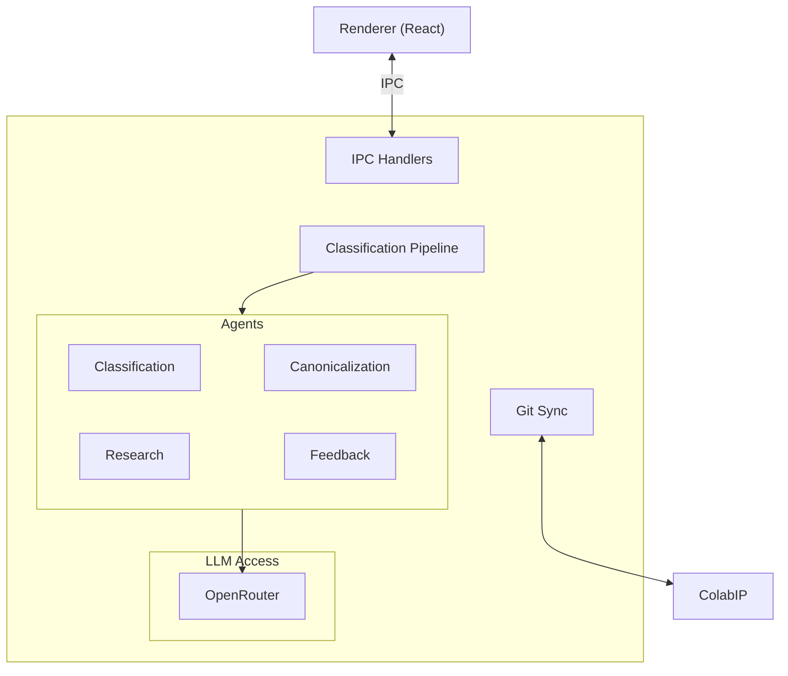
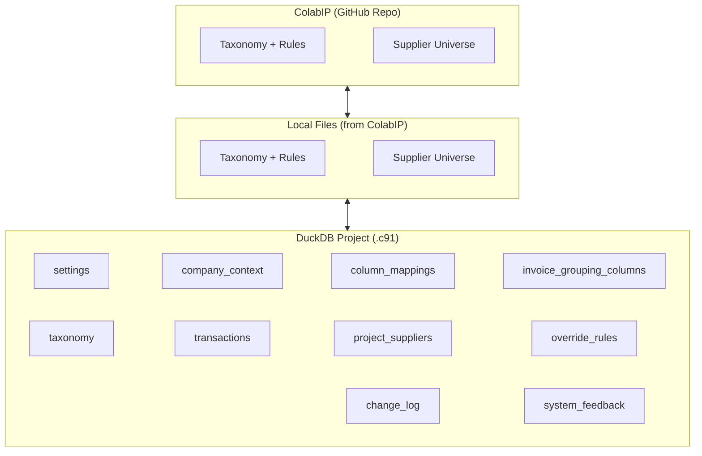

# Backend Spec Doc

> **References:** Product decisions and feature definitions are in [features.md](./features.md). Database schema in [schema.md](./schema.md). For implementation code details, see [IMPLEMENTATION.md](./IMPLEMENTATION.md) and the root [CLAUDE.md](../CLAUDE.md).

## Process Architecture — Main Process (Electron / Node.js)

## Storage Architecture

---

## Data

### Colab91 IP Master

> See [features.md §10](./features.md) for sync behavior.

**Location:** GitHub Repo

**File Specifications:**
- Taxonomy [.txt] — per-taxonomy node files
- Taxonomy Rules [.csv] — per-taxonomy rules (stored alongside taxonomy files)
- Supplier Universe [.csv] — global master list of known suppliers + parents

### Project Files (.c91)

> See [features.md §1](./features.md) for project management behavior.

**Project Storage:** Projects saved to `./projects/` folder by default (added to .gitignore). Users can also open projects from any location.

**Project Discovery:** Recent projects tracked in `~/.config/Colab91 Classifier/recent-projects.json`

**Tables in each .c91 file:**

> See [schema.md](./schema.md) for complete schema definitions.

*Configuration Tables:*
- **settings** — key-value config (tail_spend_threshold, taxonomy_name, max_depth, created_at)
- **company_context** — single row with industry, sector, description, business_focus, procurement_nuances
- **column_mappings** — maps CSV columns to canonical names
- **invoice_grouping_columns** — columns to group transactions by for classification

*Taxonomy:*
- **taxonomy** — hierarchy nodes (L1→L2→L3), descriptions, parent relationships. Taxonomy metadata (name) stored in `settings`.

*Data Tables:*
- **transactions** — dynamic schema: fixed columns (id, raw_data, classification results with `review_score` 0-100 integer) + canonical columns added from column_mappings
- **project_suppliers** — suppliers with parent_name, `supplier_type` (company/individual/government/null), supplier_info (JSON), Category A designation (`category_a`, `category_a_taxonomy_node_id`), transaction_count, total_spend
- **override_rules** — rules with name, source (`project`/`taxonomy`/`supplier`), conditions (JSON), target_classification, priority_score. `supplier` and `taxonomy` rules synced at classification time; `project` rules created directly.
- **change_log** — audit trail: change_type, source, affected_table, old/new values
- **system_feedback** — AI-generated suggestions: feedback_type, action_details (JSON), status

### Local Files

**Details:** Pulled from GitHub. Not intended for manual user changes.

- Taxonomy [.txt]
- Taxonomy Rules [.csv] — per-taxonomy, stored alongside taxonomy files
- Supplier Universe [.csv]

---

## Flow

### Thread 0: Start App

- Load runtime settings from environment/config
- Load recent projects index from `~/.config/Colab91 Classifier/recent-projects.json`
- Ensure `./projects/` folder exists
- No database initialization needed (databases are created per-project)

---

### Thread 1: Project Setup

#### 1.1 Create or Open Project

**IPC Handlers:** `project:new`, `project:open`, `project:close`, `project:getMetadata`, `project:updateMetadata`

**Create New Project:**
1. User clicks "New Project" → prompt for project name (not location)
2. Create `.c91` file in `./projects/{name}.c91`
3. Initialize all tables in the `.c91` file
4. Optionally import taxonomy and rules from colabip
5. Set company context and settings
6. Automatically add to recent projects index

**Open Existing Project:**
1. User selects from recent projects list (shows projects from any location)
2. OR clicks "Open from elsewhere..." → native open dialog for external `.c91` file
3. Open DuckDB connection to selected file
4. Add to recent projects index
5. All data is already there — ready to use

**Recent Projects:**
- **IPC Handlers:** `recentProjects:list`, `recentProjects:remove`, `recentProjects:clear`
- Tracks all recently opened projects (both ./projects/ and external)
- List shown on app launch for quick access
- Clicking a recent project opens it directly

#### 1.2 Process Taxonomy Data

**IPC Handlers:** `taxonomy:importFromColabip`, `colabip:listTaxonomies`, `taxonomy:getNodes`

- List available taxonomies from colabip → `colabip:listTaxonomies` → returns industry names with node counts
- Import taxonomy → `taxonomy:importFromColabip` → copies taxonomy from colabip into project's `taxonomy_nodes` table, stores metadata (name, version) in `settings` table. Associated taxonomy rules from ColabIP are synced into `override_rules` at classification time with `source='taxonomy'`.
- Each project contains its own complete copy of the taxonomy for portability

**Future:** UI to upload a new taxonomy to ColabIP

#### 1.3 Project Settings

**IPC Handlers:** `project:updateMetadata`, `rules:create`

- User updates company context → `project:updateMetadata` → updates `company_context` table
- User sets tail spend threshold → `project:updateMetadata` → updates `settings` table
- User adds override rule → `rules:create` → new row in `override_rules` with `source`="project"

---

### Thread 2: Prepare and Review Data

#### 2.1 Upload

> See [features.md §2](./features.md) for data import behavior.

**IPC Handlers:** `upload:selectFile`, `upload:parsePreview`, `upload:csv`

- User selects file → `upload:selectFile` → native file dialog for CSV selection
- Preview file → `upload:parsePreview` → parse headers + sample rows (10 rows)
- Upload CSV → `upload:csv` → parse full file → insert rows into transactions (in current project's `.c91` file)
- On insert → apply column_mappings to map columns to canonical fields
- Store original row as `raw_data` JSON for reference

#### 2.2 Canonicalization (LLM-first)

**IPC Handlers:** `upload:parsePreview` (extended), `canonicalization:save`

- `upload:parsePreview` now **automatically** calls the CanonicalizationAgent after parsing the CSV. The response includes both the CSV preview and the LLM's suggested mappings (`CSVPreviewWithMappings`):
  - CSV columns, sample rows, total row count
  - Suggested mappings (canonical column → client column)
  - Confidence level and reasoning
  - Unmapped columns list
  - If the LLM call fails, the preview is still returned with an empty `CanonicalizationResult` (confidence: 'low', empty mappings) so the user can map manually
- The separate `canonicalization:suggest` IPC channel has been **removed** — suggestions are bundled into the preview response
- User reviews and edits the pre-populated mappings → `canonicalization:save` → update `column_mappings` table
- User sets invoice grouping columns → update `invoice_grouping_columns` table
- On confirmation:
  - Extract distinct suppliers from transactions using supplier_name column → insert into project_suppliers

**Constraint:** Mapping is applied at upload time. If mapping is changed after data exists, existing rows are NOT re-mapped. The `raw_data` column always contains the original CSV row.

#### 2.3 Data Review

**IPC Handlers:** `transactions:stats`, `transactions:query`, `suppliers:list`, `suppliers:update`

- Data quality stats → `transactions:stats` → aggregate query (total rows, total spend, classified %, flagged for review count)
- Data summary → `transactions:query` with filters → paginated transaction results
- Supplier list → `suppliers:list` → query project_suppliers with transaction_count, total_spend
- User updates supplier → `suppliers:update` → update project_suppliers (parent_name, supplier_type, supplier_info)

---

### Thread 3: Classification

#### 3.1 Start Classification

**IPC Handlers:** `classification:start`, `classification:status`, `classification:cancel`

1. Start classification → `classification:start` → creates in-memory run tracker (scope, status="pending")
   - `status` follows: `pending` → `researching` → `classifying` → `completed` / `failed` / `cancelled`
   - Run state is tracked in-memory only (no database table). Only one job at a time.
2. ClassificationPipeline orchestrates the job (operates on currently open project). See §3.3 for pipeline steps.
3. Progress updates → emit `classification:progress` IPC event with progress_percentage
4. Update transactions with classification results (classification_path, review_score, classification_reasoning)

#### 3.2 Job Progress

**IPC Handlers:** `classification:getStatus`, `classification:cancel`, `classification:progress` (event)

- Poll status → `classification:getStatus` → returns current in-memory run state with status, progress_total, progress_processed, progress_percentage
- Real-time updates → renderer listens to `classification:progress` IPC event
- Cancel → `classification:cancel` → sets status="cancelled", stops pipeline processing

#### 3.3 Classification Pipeline

> See [features.md §5](./features.md) for priority hierarchy and classification rules. See [features.md §6](./features.md) for review score definition.

**Input:** Classification options (`scope`, `filterCriteria`). Pipeline reads taxonomy, company_context, and tail_spend_threshold from the open project.

**Step 1: Supplier research**

> See [features.md §4](./features.md) for research behavior and fallback chain.

- Query all suppliers in the project that lack research data (`supplier_info` is null or `supplier_type` is null)
- For each unresearched supplier, run the ResearchAgent using the fallback chain: existing data → name + web/LinkedIn → name + address → name + client name
- Research runs in parallel batches to manage API cost/latency
- Store results: `supplier_type` in dedicated column, remaining fields in `supplier_info` JSON

**Step 2: Identify rows to classify**

> See [features.md §5](./features.md) for classification scope feature description.

Query Transactions based on scope (from current project file):
- `"all"` → all rows in the project
- `"new"` → rows where `dataset_run_id` is null
- `"filtered"` → rows matching filter criteria passed from the UI (supplier_name, classification_path, review_score range, spend range, etc.)

**Step 3: Sync override rules**

Clear `supplier` and `taxonomy` rows from `override_rules`. Rebuild from:
- Category A suppliers in `project_suppliers` (where `category_a = TRUE`) → `source='supplier'`, priority_score band 300-399
- Taxonomy rules from ColabIP (`taxonomies/{industry}/rules.csv`) → `source='taxonomy'`, priority_score band 200-299
- Project rules (`source='project'`, priority_score band 100-199) are already in the table.

**Step 4: Apply override rules**

For each rule (sorted by priority_score ascending), query all matching rows and set their classification. First match wins. Set `review_score`=0 for matched rows.

**Step 5: Group remaining rows by invoice**

- Rows not classified by override rules get grouped using invoice grouping columns (from `invoice_grouping_columns`)
- If no grouping columns specified → each row is its own group

**Step 6: Description cleaning**

- For each transaction's invoice description: if numeric characters constitute 70%+ of the content, strip the numeric characters
- Cleaning is applied only for prompt construction — raw data in the database remains unchanged

**Step 7: LLM classification**

> See [features.md §5](./features.md) for description prioritization and L1 constraints.

For each group:
1. Check if total spend < `tail_spend_threshold` → may use simplified prompt
2. Build prompt:
   - Taxonomy tree (paths + descriptions)
   - Company context (industry, sector, business focus, procurement nuances)
   - Supplier research info (type, offerings, website, industry) — prioritized over line/GL descriptions per [features.md §5](./features.md)
   - Supplier historical L1/L2/L3 classifications (provided to LLM for review score computation)
   - Transaction details (supplier_name, gl_description, line_description, spend_amount)
   - L1 constrained to Direct/Indirect/Exempt per [features.md §3](./features.md)
3. ClassificationAgent calls LLM provider (Anthropic Claude or OpenAI GPT based on config)
4. LLM returns: classification_path (L1|L2|L3), review_score (0-100), reasoning, description_supplier_aligned (boolean — whether line/GL desc aligns with supplier info)
5. Write classification results to transactions (`classification_path`, `review_score`, `classification_reasoning`)

**Step 8: Finalize**

- Update in-memory run state (`status`="completed", `completedAt`=now)
- Log completion to change_log
- If error mid-process → `status`="failed", store error message in-memory, rows processed so far remain classified

---

### Thread 4: Review + System Improvement

> See [features.md §7](./features.md) for review behavior and [features.md §8](./features.md) for system feedback.

#### 4.1 Explore + Correct

**IPC Handlers:** `transactions:query`, `transactions:stats`, `transactions:reclassify`

- Query transactions → `transactions:query` with filters (supplier_name, classification_path, review_score range, spend range)
- Metrics → `transactions:stats` → aggregate totals (total rows, total spend, flagged for review count)
- User reclassifies rows → `transactions:reclassify` → update transactions (`classification_path`) → insert row in change_log (change_type="classification", source="manual", old_values, new_values)

#### 4.2 System Feedback

**IPC Handlers:** `feedback:list`, `feedback:approve`, `feedback:reject`

- User submits feedback → FeedbackAgent analyzes correction context → generates suggestion
- FeedbackAgent returns one of:
  - `company_context`: Update company business focus
  - `taxonomy_description`: Clarify category definition
  - `supplier_rule`: Create an override rule for the supplier
  - `uncategorized_feedback`: Surface to developers
- Insert row in system_feedback (`feedback_type`, `action_type`, `action_details` JSON, `status`="pending")
- User approves → `feedback:approve` → apply change, update status="approved"
- User rejects → `feedback:reject` → update status="rejected"

---

### Thread 5: Stores

> See [features.md §9](./features.md) for data store features.

#### 5.1 Taxonomy Store

**IPC Handlers:** `taxonomy:get`, `taxonomy:getNodes`, `colabip:listTaxonomies`, `taxonomy:importFromColabip`

- Get current taxonomy → `taxonomy:get` → returns taxonomy metadata from current project
- Browse hierarchy → `taxonomy:getNodes` → returns all taxonomy_nodes from current project
- List available taxonomies → `colabip:listTaxonomies` → lists industries from colabip directory
- Import taxonomy → `taxonomy:importFromColabip` → copies taxonomy into current project

#### 5.2 Supplier Database

**IPC Handlers:** `suppliers:list`, `suppliers:update`

- List suppliers → `suppliers:list` → query project_suppliers with supplier_type, category_a status, transaction_count, total_spend
- Update supplier → `suppliers:update` → update parent_name, supplier_type, supplier_info, category_a, category_a_taxonomy_node_id

#### 5.3 Override Rules

**IPC Handlers:** `rules:list`, `rules:create`, `rules:delete`

- List rules → `rules:list` → query override_rules from current project
- Create rule → `rules:create` → insert row with name, source (`project`/`taxonomy`/`supplier`), conditions (JSON array), target_classification, priority_score
- Edit rule → `rules:update` → update any rule regardless of source
- Delete rule → `rules:delete` → delete row from override_rules

#### 5.4 Company Context

**IPC Handlers:** `project:getMetadata`, `project:updateMetadata`

- View company context → part of `project:getMetadata` response (from `company_context` table)
- Update context → `project:updateMetadata` with companyContext field → update `company_context` table

#### 5.5 Version History

**IPC Handlers:** `changelog:list`, `feedback:list`

- List changes → `changelog:list` → query change_log from current project
- List feedback → `feedback:list` → query system_feedback with pending/approved/rejected status
- Revert → read old_values from change_log entry → restore values → insert new change_log entry (source="revert")

---

### Thread 6: Output

> See [features.md §10](./features.md) for export and sync behavior.

#### 6.1 Export

**IPC Handlers:** `export:selectPath`, `export:export`

1. Select export path → `export:selectPath` → native save dialog
2. Export → `export:export` → query transactions from current project → serialize to CSV
3. Write file to selected path

#### 6.2 Sync to ColabIP

**IPC Handlers:** `sync:pull`, `sync:push`, `sync:status`

1. Pull latest → `sync:pull` → git fetch, stash local changes, pull, pop stash
2. Push changes → `sync:push` → serialize taxonomy/rules → git add, commit, push
3. Check status → `sync:status` → return ahead/behind counts
4. If conflict → surface to user for resolution

---

## LLM Provider Configuration

The application supports multiple LLM providers:

| Provider | Models | Default |
|----------|--------|---------|
| Anthropic | claude-3-5-haiku-latest, claude-sonnet-4-20250514, claude-opus-4-20250514 | claude-3-5-haiku-latest |
| OpenAI | gpt-4o, gpt-4o-mini, gpt-4-turbo | gpt-4o-mini |

**IPC Handlers:** `settings:get`, `settings:update`, `settings:getModels`, `settings:getProviders`

Runtime-switchable via settings UI or environment variables:
- `CLASSIFIER_LLM_PROVIDER` - Default provider (anthropic/openai)
- `CLASSIFIER_MODEL` - Default model
- `ANTHROPIC_API_KEY` / `OPENAI_API_KEY` - API keys

---

## Implementation Details

For detailed implementation documentation including:
- Full database schema with SQL
- TypeScript interfaces
- Agent implementations
- Service architecture

See [IMPLEMENTATION.md](./IMPLEMENTATION.md) and the root [CLAUDE.md](../CLAUDE.md).
